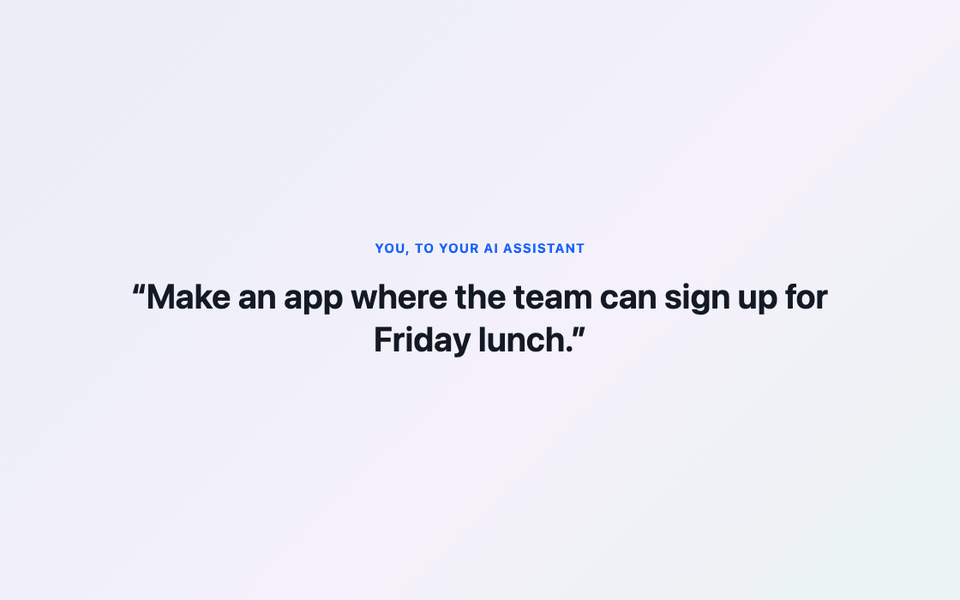
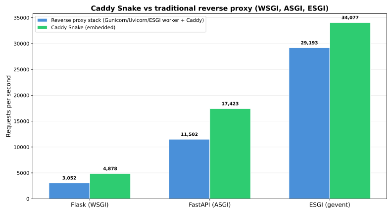

<p align="center"><a href="https://caddy-snake.readthedocs.io/en/latest/"></a></p>

# Caddy Snake

[](https://github.com/mliezun/caddy-snake/actions/workflows/integration-tests-linux.yml)
[](https://github.com/mliezun/caddy-snake/actions/workflows/integration-tests-macos.yml)
[](https://github.com/mliezun/caddy-snake/actions/workflows/integration-tests-windows.yml)
[](https://raw.githack.com/wiki/mliezun/caddy-snake/coverage.html)
[](https://caddy-snake.readthedocs.io/en/latest/)
[](https://deepwiki.com/mliezun/caddy-snake)

**Build and share small internal web apps with your own AI assistant.** One program on one machine: you ask your assistant for an app, it writes and publishes it, and you get an address to share with your team.



Caddy Snake is two things in one program:

| | |
|---|---|
| **[Apps](#apps)** | A place for small internal apps, built through an AI assistant. Start here. |
| **[The Caddy plugin](#the-caddy-plugin)** | Runs Python web apps inside [Caddy](https://github.com/caddyserver/caddy), with no separate app server. Apps is built on it. |

---

## Apps

### Quick start

You need Python 3.13+ and the Postgres programs (macOS: `brew install postgresql@18`; Debian/Ubuntu: `sudo apt install postgresql`; Windows: the installer from [postgresql.org](https://www.postgresql.org/download/windows/)).

```bash
pip install caddysnake
caddysnake apps
```

```
caddy-snake apps is running.
  Open:               http://localhost:9080/
  Assistant (MCP):    http://localhost:9080/_apps/mcp
```

Give the assistant address to any assistant that can use [MCP](https://modelcontextprotocol.io) tools (Claude, ChatGPT, Cursor, Claude Code and others). With Claude Code:

```bash
claude mcp add --transport http apps http://localhost:9080/_apps/mcp
```

Then ask for something:

> Make an app where the team can sign up for Friday lunch.

### What you get

- **An address per app**: `/<app-name>/`, each with its own Postgres database. The server creates and runs a private Postgres for you.
- **Versions**: every save is a version. A version that does not start is refused and the running one stays up. Go back to any earlier one.
- **Drafts**: a private copy of an app, with a copy of its data, for trying changes safely.
- **A dashboard**: apps, versions, settings, activity, people and access keys.
- **Sign-in when you need it**: open on your own computer, usernames and passwords for anything wider, automatic HTTPS with a domain.
- **Bring your own assistant**: no AI is included.

### Share it with your team

| Situation | How to start it |
|-----------|-----------------|
| Just this computer | `caddysnake apps` |
| A trusted private network | `caddysnake apps --listen 0.0.0.0:9080 --open-to-network` |
| Anywhere else | `caddysnake apps --listen 0.0.0.0:9080 --require-login` |
| With automatic HTTPS | `caddysnake apps --domain apps.example.com --require-login` |

Run it as a service that starts with the machine (systemd, launchd or a Windows service):

```bash
caddysnake apps install --domain apps.example.com --require-login
```

### Documentation

| | |
|---|---|
| [Apps](https://caddy-snake.readthedocs.io/en/latest/docs/apps) | Overview and quick start |
| [Connect an assistant](https://caddy-snake.readthedocs.io/en/latest/docs/apps/assistant) | The address, the tools, access keys, git |
| [How apps work](https://caddy-snake.readthedocs.io/en/latest/docs/apps/how-apps-work) | What an app is made of, publishing, drafts |
| [Share it with your team](https://caddy-snake.readthedocs.io/en/latest/docs/apps/sharing) | Sign-in and what is protected |
| [Run it for real](https://caddy-snake.readthedocs.io/en/latest/docs/apps/running) | Service install, settings file, Docker, Windows, every option |

---

## The Caddy plugin

Caddy Snake started as, and still is, a Caddy plugin that **runs Python web apps directly inside Caddy**. Caddy starts Python worker processes and talks to them over a local socket: no Gunicorn or Uvicorn, no reverse-proxy configuration, and automatic HTTPS. It works with Flask, Django, FastAPI and any other WSGI or ASGI app.

### Quick start

```bash
pip install caddysnake fastapi
```

```python
# main.py
from fastapi import FastAPI

app = FastAPI()


@app.get("/hello")
def hello():
    return {"message": "Hello world!"}
```

```bash
caddysnake --server-type asgi --app main:app
curl http://127.0.0.1:9080/hello
```

Or in a Caddyfile, with a Caddy that includes the plugin:

```Caddyfile
http://localhost:9080 {
    python /* {
        module_asgi "main:app"
    }
}
```

### Features

- **WSGI and ASGI**, with the kind detected automatically if you want (`module_auto`)
- **Worker processes**, WebSockets, streaming uploads, ASGI lifespan events
- **Many apps in one server**: Caddy placeholders load a different app per host or path, on first request
- **Autoreload** for development
- **Shared cache** between workers, optionally across several Caddy servers
- **On-demand HTTPS** for wildcard hosts, allowed by a folder existing on disk
- **Isolation** of workers in Docker containers, memory limits, request size limits
- **Ways to get it**: `pip`, pre-built binaries with Python inside, Docker images, your own `xcaddy` build, or your app packaged as one executable

### Documentation

| | |
|---|---|
| [Quickstart](https://caddy-snake.readthedocs.io/en/latest/docs/intro) | First app in five minutes |
| [Installation](https://caddy-snake.readthedocs.io/en/latest/docs/installation) | PyPI, binaries, Docker, building from source |
| [Examples](https://caddy-snake.readthedocs.io/en/latest/docs/examples) | Flask, FastAPI, Django, Socket.IO, many apps per server |
| [Configuration](https://caddy-snake.readthedocs.io/en/latest/docs/reference) | Every `python` directive and command-line flag |
| [Architecture](https://caddy-snake.readthedocs.io/en/latest/docs/architecture) | Workers, sockets, errors, limits |
| [Standalone apps](https://caddy-snake.readthedocs.io/en/latest/docs/embed-app) | Your app, Caddy and Python in one file |

### Benchmarks

Caddy Snake compares favorably to **separate reverse-proxy stacks** for **Flask (WSGI)** and **FastAPI (ASGI)** on the JSON `/hello` workload below. Figures are the averages committed in [`benchmarks/results.json`](benchmarks/results.json) from a **4 vCPU / 16 GB cloud VM (linux/amd64)** run of the Docker harness; use local Docker or [`benchmarks/scaleway_bench.sh`](benchmarks/scaleway_bench.sh) to reproduce on other hardware.



| Configuration | Requests/sec | Avg Latency (ms) | P99 Latency (ms) |
|---|---|---|---|
| Flask + Gunicorn + Caddy | 3,052 | 32.70 | 37.68 |
| **Flask + Caddy Snake** | **4,878** | **20.49** | **28.25** |
| FastAPI + Uvicorn + Caddy | 11,502 | 8.70 | 91.46 |
| **FastAPI + Caddy Snake** | **17,423** | **5.72** | **8.85** |

Caddy Snake serves **~60% more requests/sec than Gunicorn** for Flask and **~51% more than Uvicorn** for FastAPI (with **10× lower P99 latency**).

> Benchmarked with [hey](https://github.com/rakyll/hey) on a **4 vCPU / 16 GB cloud VM (linux/amd64)**: 100 concurrent connections, 10 s per run, 10 runs averaged, Python 3.13, Go 1.26 (Docker harness in [`benchmarks/`](benchmarks/)). Absolute throughput varies by machine; relative ordering has been stable across environments.

---

## Platform support

| Platform | Plugin | Apps | Notes |
|----------|--------|------|-------|
| Linux (x86_64, arm64) | yes | yes | Primary platform |
| Linux (riscv64) | yes | not tested | Cross-compiled; the plugin is tested under QEMU |
| macOS | yes | yes | |
| Windows | yes | yes | Workers use loopback TCP instead of Unix sockets |

**Python versions:** 3.13, 3.14, 3.15, and their free-threaded builds.

## Development

```bash
./scripts/qa.sh
```

[`AGENTS.md`](AGENTS.md) describes how the project is organised, the checks to run and how releases are made.

## License

[MIT License](/LICENSE).
